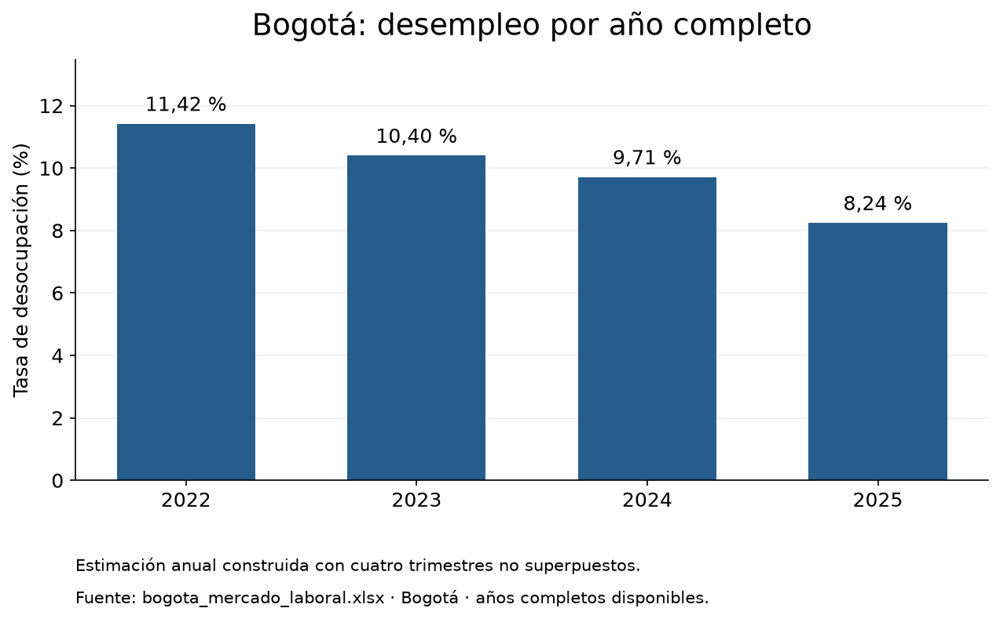
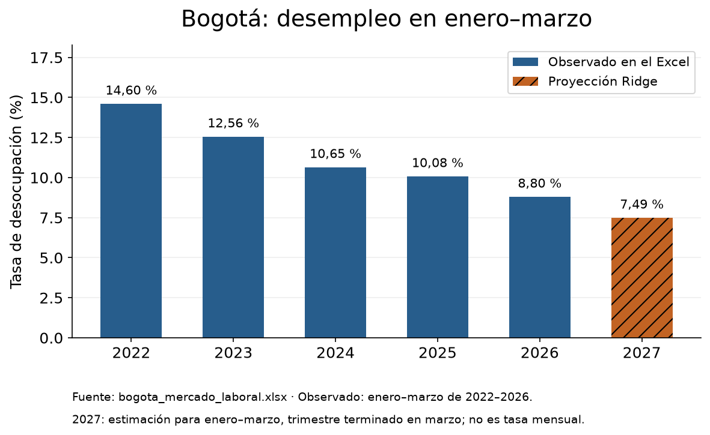

# Desempleo en Bogotá: análisis 2022–2026 y proyección

Análisis de la tasa de desempleo en Bogotá con datos abiertos y una proyección exploratoria para enero–marzo de 2027.

## Contexto

Quería ver cómo ha cambiado el desempleo en Bogotá entre 2022 y 2026: si ha bajado o subido, cuánto, y qué podría esperarse para el primer trimestre de 2027 si la tendencia de estos años se mantiene.

## Datos

Uso el conjunto "Mercado laboral Bogotá" de Datos Abiertos Bogotá, publicado por la Secretaría Distrital de Desarrollo Económico (`bogota_mercado_laboral.xlsx`, con su diccionario en `bogota_metadatos.xlsx`). Trae 49 trimestres móviles, desde enero–marzo de 2022 hasta enero–marzo de 2026, con ocupados, desocupados, fuerza de trabajo, informalidad y las tasas principales del mercado laboral.

## Herramientas

Python, pandas, NumPy, Matplotlib, scikit-learn y Jupyter Notebook.

## Resultados

### Desempleo por año

La tasa anual estimada bajó de 11,42 % en 2022 a 10,40 % en 2023, 9,71 % en 2024 y 8,24 % en 2025. La calculé con los cuatro trimestres del año que no se cruzan (enero–marzo, abril–junio, julio–septiembre y octubre–diciembre), así que es una estimación propia y no la cifra anual oficial. 2026 no aparece porque solo tiene el primer trimestre.

### Enero–marzo y proyección para 2027

En enero–marzo el desempleo pasó de 14,60 % en 2022 a 8,80 % en 2026, bajando todos los años. La barra naranja es la proyección para enero–marzo de 2027: 7,49 %, unos 1,31 puntos menos que en 2026.

## Cómo hice la proyección

Usé una regresión Ridge, un modelo lineal que predice la tasa de cada periodo a partir de las tasas de periodos anteriores y del mes del año. Para probarlo, lo entrené con los datos hasta marzo de 2025 y le pedí predecir los 12 periodos siguientes sin mostrarle los valores reales. Se equivocó en promedio 1,41 puntos porcentuales, frente a 2,05 puntos si simplemente repetía el último valor conocido.

La proyección es exploratoria. Hay pocos datos, los trimestres móviles comparten meses entre sí y los errores se pueden acumular al proyectar varios pasos hacia adelante. No incluye un rango de incertidumbre ni explica las causas de los cambios en el desempleo.

## Archivos

- `investigacion_empleo_bogota.ipynb`: notebook con todo el análisis.
- `bogota_mercado_laboral.xlsx` y `bogota_metadatos.xlsx`: datos y diccionario.
- `desempleo_anual.png` y `proyeccion_ene_mar_2027.png`: gráficas exportadas desde el notebook.
